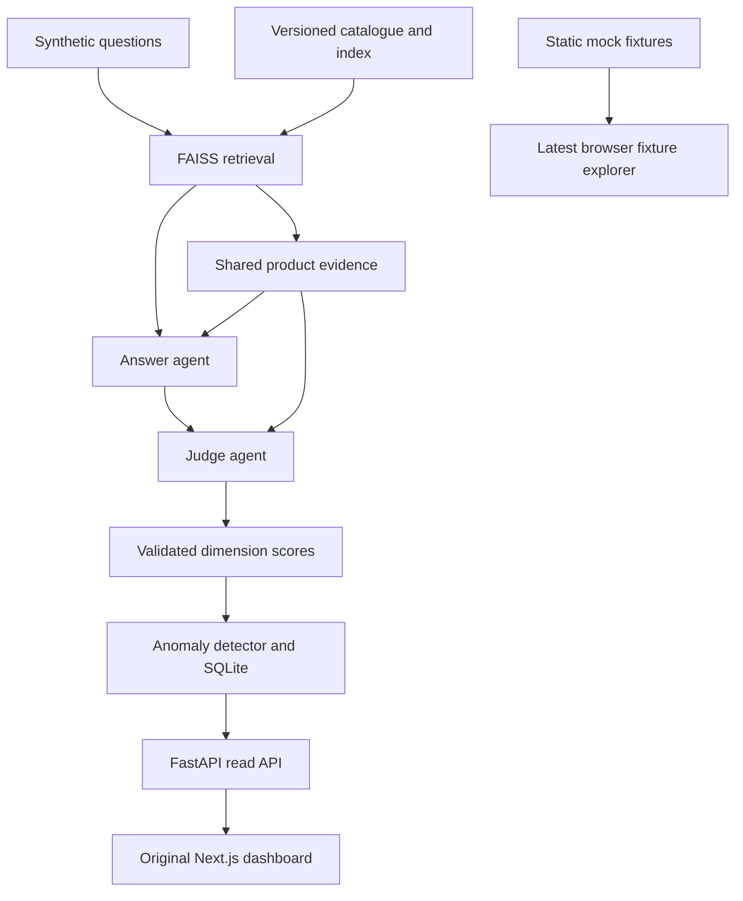
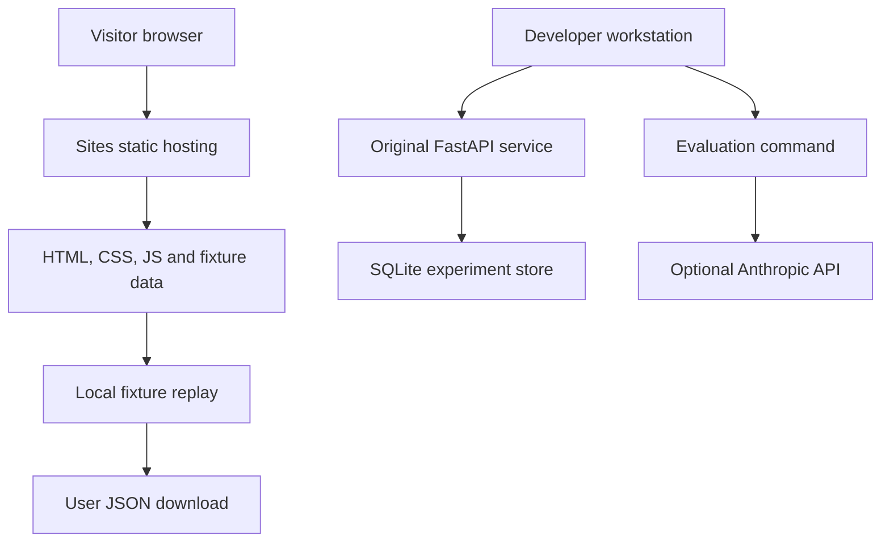

# Engineering design and release boundaries

Review date: 14 November 2026. Original source reviewed at commit `36bd80d3d0376f545bcd16a48212fc7d1b5f6b50`.

## Product purpose

Evaluate a simulated shopping assistant against a supplied synthetic catalogue. The original retrieval/answer/judge/database pipeline and Next.js dashboard remain the executable application. The latest browser presentation adds a deterministic fixture explorer, scoring explanations and architecture documentation. Its replay results are computed from repository fixtures, not fresh LLM judgements or production Amazon Rufus measurements.

## System architecture

### Preserved data model

`backend/evaluation/anomaly.py` owns `eval_results` and `eval_runs`. Result identity, timestamp, question/category, adversarial fields, answer text, four dimension scores, weighted overall and anomaly fields remain unchanged. No migration or historical-result rewrite is introduced. Score validation happens before anomaly analysis and persistence. Existing stored results retain their original values and provenance limitations.

### Correctness improvements

1. **Equal evidence:** `backend/agents/product_context.py` supplies names, prices, ratings, brands, non-null specifications and descriptions to both agents. Previously the judge lacked specifications and descriptions available to the assistant, undermining hallucination assessment.
2. **Strict metric boundary:** `backend/agents/scoring.py` rejects missing dimensions, booleans, numeric strings, non-finite numbers and scores outside 0–10. Invalid model output raises a `ValueError`; it cannot silently create a zero measurement or enter normal aggregate metrics.
3. **Recomputed overall:** the application calculates `0.30H + 0.30A + 0.30G + 0.10S`, rounded to two decimals. A model's claimed overall is not authoritative. The normal fixture is corrected from 9.0 to 8.8; existing historical records are not rewritten.
4. **Contract integrity:** reasoning must be text; optional summary, adversarial flag and failure dimension are type-checked. JSON parsing still handles fenced JSON, while semantic validation is a separate responsibility.

## Architecture decisions

| Decision | Reason | Trade-off / reconsider when |
| --- | --- | --- |
| Shared, dependency-free catalogue formatter | Prevent evidence drift between answer and judge | Large contexts require a shared explicit truncation policy; do not truncate each independently |
| Fail invalid judgements before persistence | A malformed evaluation is not a low-quality answer | Batch execution currently stops; add explicit failed-job records and retry budgets before unattended operation |
| Locally recomputed weighted overall | Consistent arithmetic across fixtures and live responses | Weights are a project rubric, requiring human calibration before comparative claims |
| SQLite and sequential batches retained | Reproducible single-user prototype; no unnecessary schema rewrite | Multiple writers or sustained workload call for job ownership, idempotency and a managed database |
| Buildless website separated from model execution | Readable, reproducible public demonstration without credentials or model costs | Live evaluation needs authenticated server execution and observed deployment verification |
| Original interface preserved | Keeps historical development and original application assessable | Website fixture replay does not replace every capability of the Next.js dashboard |

## Deployment architecture

The Sites artifact serves static HTML, CSS and JavaScript. Fixture selection and score calculation run entirely in the visitor's browser; export creates a local JSON download. It has no credential input, model provider connection, server database or API write path.

The original `render.yaml` describes a separate FastAPI deployment, not infrastructure created by this update. For live hosting, validate exact allowed origins, authentication, rate budgets, persistent database storage, catalogue/index compatibility and server-only secrets. A successful static website publication proves only the browser artifact is deployed.

## Professional engineering practices

- Keep pure validation independent of SDK/network imports, enabling fast deterministic regressions.
- Reject invalid data at the first boundary; do not silently reinterpret malformed values.
- Keep synthetic fixtures, model outputs and human review evidence distinct.
- Version catalogue, index, prompts, model identifiers and rubric together for future experiments.
- Preserve existing schemas and make any future migration explicit and reversible.
- Review current deployment evidence before describing a service as live.
- Record test scope precisely: passing offline contracts does not prove retrieval quality, calibration or production capacity.

## Operational recovery

On invalid judge output, retain the exception and input/run identifiers in a controlled diagnostic channel; do not publish raw customer prompts or secrets. Investigate whether the error is provider formatting, truncation or rubric mismatch before retrying. The current pipeline does not persist a separate failure record, so an unattended job runner is a future enhancement. Restore a prior commit to roll back code; back up the SQLite file before experiments that mutate it. Never mix fixture-only scores into a live evaluation report.

## Verification

Run `python -m unittest discover -s tests/offline -v`. New score-boundary tests cover invalid/non-finite values, missing dimensions, metadata types, exact weighted aggregation, complete shared catalogue evidence and input non-mutation. Existing tests check mock mode, adversarial fixture isolation and non-blocking SDK handoff. The frontend was not modified by this update; its existing typecheck/build/CI instructions remain in the main README.

### Observed checks in the editing environment

- Seven new pure score-boundary tests passed.
- Four synchronous agent integration tests passed: shared context, six fixture totals, fixture isolation and UTF-8 currency decoding.
- JavaScript syntax and six replay scenarios passed under Node, including isolation, invalid scenario rejection and required UI elements.
- Python compilation passed for the edited agent modules and offline tests.
- The full legacy offline suite did not complete in the host runtime: its installed Anthropic/httpx combination failed client construction, and asynchronous tests stalled. Those runs were stopped. The repository's pinned dependency environment and hosted CI remain the appropriate place to rerun the complete suite. Browser visual QA and live-provider execution were not performed.

## Skills demonstrated

Python async orchestration; retrieval-augmented generation; FAISS vector search; model evaluation; adversarial scenario design; data contracts and validation; FastAPI API design; SQLite persistence; Next.js interfaces; regression testing; architecture documentation; deployment boundaries and evidence-led technical communication. This is an independent portfolio project, not a Keele assessed module; no academic mark is claimed.
